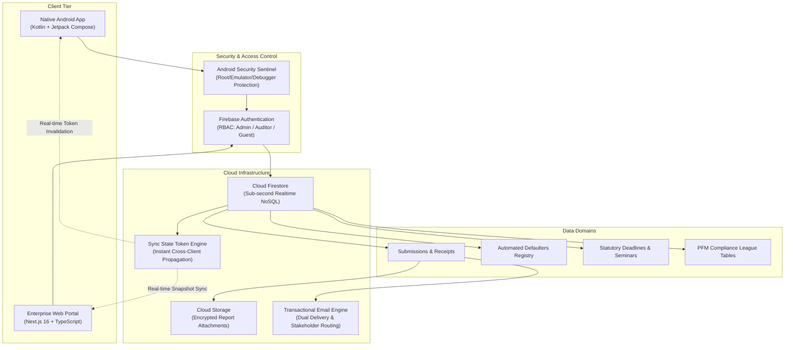
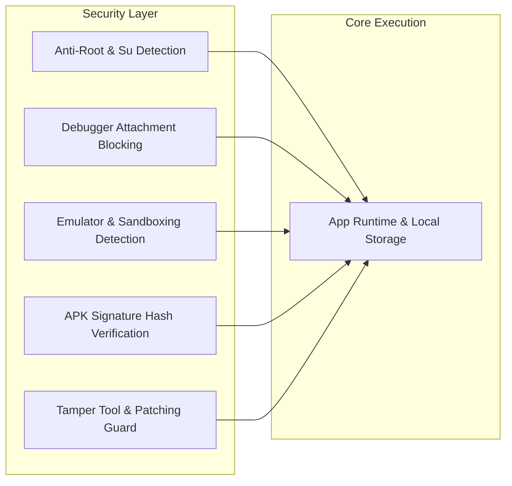

# CONFIDENTIAL COMMERCIAL ASSET SPECIFICATION & INVESTOR PROSPECTUS

**PROJECT TITLE:** INTERNAL AUDIT AGENCY COMPLIANCE & STATUTORY REPORTING PLATFORM ("IAA APP")  
**PROPRIETARY OWNER & DEVELOPER:** BibiniiTech Limited  
**DOCUMENT VERSION:** 2.4 Enterprise Release  
**CLASSIFICATION:** STRICTLY CONFIDENTIAL // PROPRIETARY COMMERCIAL ASSET  
**TARGET AUDIENCE:** Potential Acquirers, Strategic Investors & Enterprise Buyers  

---

## NON-DISCLOSURE, PROPRIETARY RIGHTS & NON-CIRCUMVENTION AGREEMENT

> [!CAUTION]
> ### NOTICE OF PROPRIETARY ASSET & LEGAL CONFIDENTIALITY
> The contents of this document, including the system design, proprietary algorithms, database schemas, workflow engines, compliance scoring logic, architectural blueprints, and commercial monetization structures, constitute valuable **Trade Secrets and Confidential Intellectual Property** of BibiniiTech Limited.
>
> By opening, inspecting, or reading this document, the recipient ("Recipient") agrees to the following legally binding terms:

1. **Non-Disclosure Obligation:**  
   The Recipient shall hold and maintain all Confidential Information in the strictest confidence. The Recipient shall not disclose, publish, distribute, or transfer any part of this document or the ideas contained herein to any third party without prior written authorization from BibiniiTech Limited.

2. **Non-Circumvention Clause:**  
   The Recipient expressly agrees not to circumvent, avoid, bypass, or obviate BibiniiTech Limited, directly or indirectly, to solicit, negotiate with, contract with, or establish commercial relations with any government agency (including the Internal Audit Agency, Ministry of Finance, Controller and Accountant-General's Department, Audit Service, or any Metropolitan, Municipal, District Assembly or State-Owned Enterprise) regarding the concepts, software implementations, or systems disclosed herein.

3. **Intellectual Property Reservation:**  
   No license, title, copyright, patent right, or ownership interest is granted or implied by the disclosure of this document. All software codebases (Native Android Jetpack Compose application, Next.js Web Application, and Cloud Firestore backend architectures) remain the exclusive property of BibiniiTech Limited until formalized under a fully executed Asset Purchase or Exclusive Technology Licensing Agreement.

4. **Prohibition of Reverse Engineering & Derivative Works:**  
   The Recipient shall not decompile, disassemble, reverse engineer, or create derivative works modeled upon the architecture, compliance tri-state categorization logic, submission routing protocols, or UI/UX workflows disclosed in this document.

5. **Remedies for Breach:**  
   The Recipient acknowledges that unauthorized disclosure or misuse of this information would cause irreparable harm for which monetary damages alone would be inadequate. BibiniiTech Limited shall be entitled to seek injunctive relief, statutory damages, and full reimbursement of legal and attorney costs in the event of any breach.

---

## 1. EXECUTIVE SUMMARY & STRATEGIC VALUE PROPOSITION

### 1.1 The Statutory Challenge
Under Ghana’s **Public Financial Management Act, 2016 (Act 921)**, the **PFM Regulations, 2019 (L.I. 2378)**, and the **Internal Audit Agency Act, 2003 (Act 658)**, hundreds of covered public entities—including Ministries, Departments, and Agencies (MDAs), State-Owned Enterprises (SOEs), Regional Coordinating Councils (RCCs), and Metropolitan, Municipal, and District Assemblies (MMDAs)—are legally required to file mandatory periodic audit and compliance reports.

Historically, this national reporting mandate has been burdened by:
- **Paper-Heavy & Dispersed Reporting:** Physical delivery of spiral-bound reports, leading to lost submissions, delayed oversight, and lack of verifiable audit trails.
- **Absence of Real-Time National Compliance Monitoring:** The oversight agency had no automated mechanism to instantaneously identify which public entities have defaulted on statutory deadlines.
- **Resource Fragmentation:** Auditors across remote districts lacked centralized access to current legislation, standardized audit committee templates, tax withholding matrices, and training opportunities.

### 1.2 The Platform Solution
The **IAA Platform** is an enterprise-grade, multi-platform GovTech and RegTech ecosystem comprising:
1. **A Native Android Mobile Application** (built with Kotlin and modern Jetpack Compose for Android 10 to Android 15+).
2. **A Responsive Enterprise Web Portal** (built with Next.js 16, React 19, and TypeScript with sub-second page delivery).
3. **A Scalable Cloud Backend** (leveraging Google Firebase Firestore, Cloud Storage, Authentication, and Transactional Mail APIs).

The platform transforms national compliance by providing:
- **Instant Digital Report Filing** with automated dual routing (cloud database logging + immediate email distribution to oversight desks).
- **Automated National Defaulters' Engine** that tracks submissions against statutory deadlines, cleanly separating on-time entities from defaulters.
- **National PFM Compliance League Table** benchmarking compliance across public institutions.
- **Embedded Financial & Audit Tooling** (graduated PAYE, Withholding Tax, VAT compound levies, findings criteria database).
- **Administrative Command Center** allowing administrators to broadcast deadlines, manage training seminars, run authenticated stakeholder votes, and monitor compliance rates in real time.

---

## 2. CROSS-PLATFORM SYSTEM ARCHITECTURE

### 2.1 Technology Stack

| Component | Android Client | Web Portal | Cloud Backend |
| :--- | :--- | :--- | :--- |
| **Language / Framework** | Kotlin 2.0+ / Jetpack Compose | Next.js 16.2 / React 19 / TypeScript | Node.js Serverless / Cloud Functions |
| **Styling & UI Design** | Material Design 3 (M3) | Custom Responsive CSS Modules | High-contrast accessibility standards |
| **Local Persistence** | Room SQLite / DataStore | Browser LocalStorage / Memory Cache | Firestore Offline Persistence Cache |
| **Authentication** | Biometric Prompt + Firebase Auth | Firebase Auth (Google OAuth & Email/Pass) | Role-Based Access Control (RBAC) Security Rules |
| **Security Sentinel** | Anti-Tamper / Emulator / Root Check | CSRF Tokens, Secure Headers, Subresource Integrity | Cloud Firestore Rules & File Validation |

### 2.2 Instant Real-Time Synchronization Engine (`syncToken`)
The platform implements a proprietary **Lightweight Real-Time Cache Invalidation Pattern**:
- An administrative change in deadlines, seminars, notices, or recipient routes immediately increments a central `lastUpdated` timestamp inside `config/sync_state`.
- Mobile devices listen to this state via Kotlin Coroutine `StateFlow` and immediately refresh local caches.
- Web clients listen via `onSnapshot` with zero full-page reload overhead.
- This provides sub-second multi-device data parity without incurring heavy continuous database read billing.

---

## 3. CORE FEATURE SPECIFICATIONS

### 3.1 Smart Submissions Portal & Automated Email Routing Engine
* **Purpose:** Allows institutional internal auditors to securely file mandatory statutory reports directly from their mobile device or desktop browser.
* **Dual Delivery Workflow:**
  1. **Database Record:** The report metadata and cloud storage download links are logged to Firestore with tamper-proof timestamps and user identification.
  2. **Automated Transactional Email Broadcast:** The platform dispatches transactional emails via Brevo relay with attached audit files directly to:
     - The designated Internal Audit Agency oversight email address.
     - Regional Coordinating Council (RCC) regional oversight desks.
     - The submitting auditor and their institution's designated CC stakeholders.
* **Report Categories Handled:**
  1. **Quarterly Internal Audit Reports:** 1st, 2nd, 3rd, and 4th Quarter submissions.
  2. **Annual Internal Audit Reports:** Annual Workplans, Strategic Plans, and Annual IA Performance Reports.
  3. **Commitment Control Compliance (CCC) Review Reports:** Periodic budget and commitment verification reports.
  4. **Status of Implementation (SOI) Reports:** Tracking recommendations from previous audit inspection reports.
  5. **Ad-Hoc & Special Reports:** Investigations, forensic requests, and board-commissioned audits.
* **Payload Enforcements & Safeguards:**
  - Strict maximum of **5 attachments** per report filing.
  - Maximum **25MB total aggregated payload** per submission.
  - Client-side mime-type verification (PDF, Word, Excel) with binary size validation.
* **Offline Resilience:** Local form auto-save debounce prevents data loss during intermittent field connectivity.

---

### 3.2 Automated National Defaulters' List & Compliance Registry
* **Purpose:** Provides oversight authorities and auditors with an objective, real-time national register of institutions that have either complied on time, submitted late, or defaulted on mandatory reporting deadlines.
* **Dynamic Date Elapse Gating:**
  - Reports where the statutory deadline has not yet elapsed in the current year display **"Not Due Yet"** alongside the scheduled date.
  - Defaulters and late lists for that report remain hidden until the deadline elapses, preventing false public naming of compliant entities.
* **Automated Tri-State Categorization:**
  - **Defaulters:** Institutions that have not submitted a matching report after the deadline has elapsed.
  - **Late Submissions:** Institutions that submitted their report after the deadline, showing exact days overdue.
  - **On-Time Submissions:** Institutions that filed on or before the statutory deadline.
* **Institution Type Segregation & Deduplication (4 Distinct Classes):**
  - **MDAs (147):** Ministries, Departments, and Agencies.
  - **SOEs (42):** State-Owned Enterprises and Commercial Entities.
  - **RCCs (16):** Regional Coordinating Councils across Ghana's 16 administrative regions.
  - **MMDAs (261):** Metropolitan, Municipal, and District Assemblies organized by administrative region.
  - *Full dataset deduplication ensures zero overlapping entities.*
* **Interactive Filtering:** Instant search by institution name, category filtering, and regional drill-downs.

---

### 3.3 Dynamic Home Dashboard & Contextual Smart Compliance Badges
* **Purpose:** A high-impact executive command screen providing instant situational awareness.
* **Hybrid Contextual Compliance Counter:**
  - **For Logged-in Auditors:** Dynamically queries the user's institution profile against upcoming deadlines in the next 30 days:
    - If all upcoming reports have been filed $\rightarrow$ Displays **`00`** with a green **"All Caught Up"** badge.
    - If reports remain unsubmitted $\rightarrow$ Displays the count with an amber **"Due Soon"** badge.
  - **For Administrators & Guests:** Displays total system-wide **"Upcoming Deadlines"** scheduled in the next 30 days.
* **Upcoming Seminars Counter:** Tracks scheduled professional training events and workshops taking place within the next 30 days.
* **Quick Access Deep-Linking:** Direct, one-click access into Quarterly submission drafts, CCC drafts, statutory legislations, and reporting templates.

---

### 3.4 PFM Compliance League Table
* **Purpose:** Fulfills the Government's national commitment to publish an objective, evidence-based performance assessment of public institutions complying with the Public Financial Management Act, 2016 (Act 921).
* **Core Capabilities:**
  - Multi-tier ranking of MDAs and MMDAs based on audit committee establishment, report timeliness, and implementation status.
  - Live search, regional filtering, and exportable ranking analytics.
  - Publicly accessible benchmark view to promote fiscal transparency and peer accountability.

---

### 3.5 Interactive PFM Tax Calculators
* **Purpose:** Provides auditors, financial controllers, and accounting officers with instant, compliant calculation engines based on current statutory rates.
* **Calculators Implemented:**
  1. **GRA 2025/2026 Graduated PAYE Income Tax Calculator:**
     - Computes monthly/annual progressive tax brackets.
     - Auto-deducts SSNIT 5.5% Tier 1 employee contributions.
     - Computes taxable income, tax charged, and net take-home salary.
  2. **Statutory Withholding Tax (WHT) Calculator:**
     - Dynamic rate selection: Goods (3%), Services/Consultancy (5% - 10%), Rent (8% / 15%), Works (5%).
     - Shows gross invoice, withheld statutory deduction, and net payment due.
  3. **Comprehensive VAT & Compounded Statutory Levies:**
     - Standard VAT (15%), National Health Insurance Levy (NHIL 2.5%), GETFund Levy (2.5%), COVID-19 Health Recovery Levy (1%).
     - Calculates base supply, individual levy breakouts, and total invoice gross.

---

### 3.6 Professional Trainings & Seminar Booking Engine
* **Purpose:** Digital hub for continuous professional development (CPD) of internal auditors.
* **Features:**
  - Topic titles, session dates, times, venue/Zoom credentials, fee structures (Free or GHS rated).
  - One-click registration routing directly to meeting or booking forms.
  - Downloadable module slides and official methodologies.

---

### 3.7 Audit Findings & Criteria Knowledge Base
* **Purpose:** Instant reference guide for field auditors conducting internal control reviews.
* **Structured 5-Element Matrix:**
  1. **Criteria:** The statutory law, regulation, or standard breached (PFM Act, Public Procurement Act, etc.).
  2. **Condition:** The factual observation found on the ground.
  3. **Cause:** Why the failure occurred (lack of oversight, inadequate training, systemic gap).
  4. **Consequence:** Financial loss, regulatory sanction, or operational exposure.
  5. **Corrective Recommendation:** Clear guidance for remediation.

---

### 3.8 Secure Stakeholder Voting & Governance System
* **Purpose:** Facilitates authenticated, tamper-resistant elections, AGM votes, and stakeholder surveys.
* **Safeguards:**
  - One-account, one-vote enforcement backed by unique cryptographic device and UID checks.
  - Real-time tallying with instant percentage visualization.
  - Time-delimited election windows with administrative control to open/close polls.

---

### 3.9 Administrative Oversight Command Center
* **Purpose:** Gives system administrators and agency leadership full operational governance over the national platform.
* **Capabilities:**
  - **Submissions Monitor:** Live 4-card monitoring dashboard showing real-time submission counts and compliance rates across MDAs, SOEs, RCCs, and MMDAs.
  - **Deadlines & Seminars Manager:** Add, edit, or purge statutory deadlines and training events with instantaneous multi-client synchronization.
  - **Dynamic Recipient Email Configurator:** Configure central and regional routing email addresses per report type with zero code modifications.
  - **User Role Management:** Approve, assign, and verify auditor profiles against master institution registries.

---

## 4. ENTERPRISE SECURITY & ANTI-TAMPER ARCHITECTURE

The mobile and web platforms incorporate defense-in-depth security measures:

1. **Android Hardware Integrity Sentinel:**
   - **Root Detection:** Verifies system partitions for `su` binaries, test-keys, and Magisk modules.
   - **Debugger Blocker:** Detects ptrace and Java debugger attachments to prevent runtime memory manipulation.
   - **Emulator Protection:** Distinguishes genuine physical hardware from virtualized test environments.
   - **Signature Verification:** Verifies the cryptographic release signing certificate hash on launch.
2. **Access Control & RBAC:**
   - Strict separation between Administrators, Verified Auditors, and Guests.
   - Only authenticated users with approved profile completion can access the submissions portal.
3. **Data Protection Compliance:**
   - Zero retention of unnecessary personal identifiers.
   - Full alignment with Ghana Data Protection Act, 2012 (Act 843) and international data governance standards.

---

## 5. COMMERCIAL OPPORTUNITY & ACQUISITION VALUE

### 5.1 Addressable Market & Deployment Scale
- **Public Sector Coverage:** Over **460+** statutory covered entities in Ghana alone (147 MDAs, 42 SOEs, 16 RCCs, 261 MMDAs), with tens of thousands of licensed internal auditors, audit committee members, and financial controllers.
- **Geographic Extensibility:** The platform's modular structure allows immediate white-label adaptation to other African nations (e.g., Nigeria, Kenya, Sierra Leone, Rwanda) operating under similar PFM and internal audit oversight frameworks.

### 5.2 Monetization & Revenue Models for an Acquirer
1. **Government Enterprise SaaS Licensing:**
   - Annual recurring enterprise license paid by the oversight agency or individual institutions for compliance monitoring and cloud submission archiving.
2. **CPD Training & Seminar Transaction Fees:**
   - Processing fee retention on paid training seminars and executive workshops booked through the platform.
3. **Verification & Audit Certification Services:**
   - Premium export of official compliance certificates for institutions undergoing external audit by national supreme audit institutions.
4. **Custom Integrations:**
   - Consulting and integration fees for direct API connectivity into national ERPs (GIFMIS, HRMIS, and banking portals).

---

## 6. ASSET TRANSFER & TECHNICAL HANDOVER

In the event of an acquisition or licensing agreement, BibiniiTech Limited is prepared to deliver:
1. **Complete Source Code Repositories:**
   - Full native Kotlin Android project codebase with complete Gradle build scripts and Android Studio configs.
   - Full Next.js 16 Web Application project codebase with React components, CSS modules, and API route definitions.
2. **Cloud Infrastructure Blueprint:**
   - Firestore security rules, indexing definitions, and Cloud Storage bucket policies.
   - Remote Config schemas and Brevo email routing scripts.
3. **Master Institutional Datasets:**
   - Clean, deduplicated JSON and TypeScript master datasets for all 147 MDAs, 42 SOEs, 16 RCCs, and 261 MMDAs.
4. **Developer & Operations Manual:**
   - Step-by-step continuous integration, deployment guidelines, and administrative handbook.
5. **Technical Support & Transition Warranty:**
   - Optional 60-day post-acquisition technical transition support and engineering advisory.

---

**FOR COMMERCIAL INQUIRIES & ACQUISITION DISCUSSIONS:**  
**BibiniiTech Limited**  
*Confidential Intellectual Property Prospectus – All Rights Reserved © 2026*
